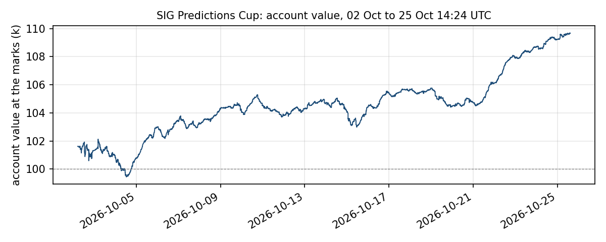

# Automated trading in a play-money election prediction market

**A trading bot for the SIG Predictions Cup (US midterm elections, October–November 2026)**

Adam Zerouali, University of Bristol. I wrote this bot for the Cup and it has traded live since the
tournament opened on 1 October 2026. This repository is the code, the tests, the analysis and a short paper.
It is a student project: the results are a few weeks of play money, not a track record.
[](https://github.com/grissou/prediction-market-maker/actions/workflows/tests.yml)
· MIT licence · Python 3.10, standard library plus `requests` (and optionally `realtime` for the pushed feed).

## 1. Summary

The SIG Predictions Cup is a month-long trading tournament. Participants start with 100,000 play-money
units and trade 237 contracts on US midterm election races through an exchange with an order book and
an API. There are no fees. Every contract pays out at the election result.

The bot trades the whole tournament on its own. I started it as a classical market maker: quote both
sides of every market, earn the gap between bid and ask, stay close to flat, take no view on who wins.
That lasted about a week. Three things I found in the live data changed the plan (§3):

- the tournament's prices are systematically biased: longshots are too dear and favourites too cheap;
- because every contract pays out at the result, that bias is a source of profit rather than noise;
- the order book is full of other trading bots, which leaves very little spread to earn.

The bot runs four strategies side by side, each with its own capital:

| Strategy | In one sentence |
|---|---|
| **Value book** | Buy where the tournament price is far from the real-money market's probability, and hold to the result |
| **Allocator** | Once an hour, sell the holdings with the least edge left and buy the opportunities with the most |
| **Market making** | Quote both sides in the middle of the probability range, with a reserve of cash the allocator keeps topped up |
| **Harvest ladder** | Trade the bias itself: resting orders that sell it only at prices better than today's |

### 1.1 Results so far (interim: 25 October 2026, day 25 of 35; the tournament ends 4 November)

| | 25 Oct 2026, 14:24 UTC |
|---|---|
| Account at the exchange's marks | **109,661** (+9.7% from 100,000) |
| Expected value at settlement (cash + positions at Polymarket *p*) | **115,067** (+15.1%) |
| Leaderboard | **152nd of 1,782** entrants (top 8.5%) |
| Lowest reading | 99,441 on 4 October (−0.56% below the start) |
| Largest peak-to-trough fall | −2.6% (3–4 October: the mark-driven selling episode of §3) |
| Edge per fill, 2–11 October, 12,981 fills | 5.3c a share; 10.9% of the cash each fill tied up; 69.5k in total |
| Realised profit on closed trades | about 3k before the 11 October rewrite, 0.8k since |



*Account value at the exchange's marks, one reading a minute. The first 37 hours are left out: with
almost no trades in most books, the trade-based marks put the account anywhere between 100k and 150k.*

Both numbers in the first two rows move every hour, and neither is a final result; the one that
matters arrives on 4 November. §6 says what each row means and which strategy earned it.

### Key terms

- **Polymarket**: a real-money prediction market that trades the same races. Its price is used as the
  estimate of the true probability of each outcome, written *p* below. 229 of the 237 contracts have a
  usable match.
- **Mark**: the price the exchange uses to value a position on its leaderboard. It is based on recent
  trades, not on the order book, and it carries the tournament's bias.
- **Expected value at the result**: cash plus every position valued at *p*. This is what the account is
  expected to be worth when the races settle. The bot reports it as `ev_outcome`.
- **Edge**: the expected gain per unit of cash a position ties up, if held to the result (§4.2).
- **The tilt**: the tournament's favourite–longshot bias, measured by one number *s* (§3.1).

## 2. The setting

| | |
|---|---|
| Contracts | 237 YES/NO contracts across 117 races (Senate, Governor and House seats, plus which party controls the House and the Senate). A race's contracts are its candidates |
| Prices | Between 0 and 1, in steps of 0.005. A YES bought at 0.30 pays 1 if the candidate wins and 0 otherwise |
| Payout | At the election result. The only earlier way out is to sell into the order book |
| Fees | None |
| Leaderboard | Cash plus positions at the exchange's marks |
| API | REST calls for orders, books, positions and P&L, plus a live feed of book changes and fills. About 100 requests a minute are allowed per account; this was measured, not published. Going over it blocks all requests for 60 seconds |

## 3. What the first days showed

**3.1 The prices carry a favourite–longshot tilt.** Across all markets, the tournament's mid price *m*
relates to Polymarket's probability *r* roughly as

```math
m \approx c + (1 - s)(r - c), \qquad c = \frac{1}{\text{number of candidates in the race}}
```

In words: prices are pulled toward "every candidate equally likely" by a factor *s*. A candidate with a
2% chance trades at 10–15c; one with a 97% chance trades at 85–88c. The bot estimates *s* every cycle
from the whole cross-section of markets. It rose from 0.046 on 2 October to 0.128 on 4 October, fell to
0.078 by 6 October, and was rising again at the time of writing (0.092). It moves over days, not minutes.

This matters in two opposite ways. Shorting longshots and holding favourites to the result earns the
tilt. But while those positions are held, a rising tilt marks them *down* on the leaderboard.

**3.2 Payout at the result changes what "profit" means.** A position bought at 85c in a candidate
with a 97% chance is expected to pay 97c, whatever the leaderboard says in the meantime. So the bot
tracks two numbers: account value at the marks (the leaderboard) and expected value at the result. Early
on, a rule that sold positions when their marks fell gave away about 3.7k of expected value in four hours
during a tilt rise. The value floor in §4.3 exists because of that.

**3.3 The book is crowded with bots.** Within hours of the open several participants were quoting
algorithmically: undercutting by one tick, re-quoting instantly, resting size at every level. Measured
fill by fill, pure market making earned tens of units a day on a 20k reserve, and the inventory it left
behind was held for a median of seven hours. Market making was kept, but as the smallest strategy.

**3.4 Cash is the binding constraint.** Every position locks up cash until the result. By day 3 more
than 90% of the account was in positions, and every strategy competed for the rest. Much of the design
is about which strategy gets the next unit of cash, and what the bot may sell, and at what price, to
raise it.

## 4. Method

### 4.1 Fair value

Each market's fair value is Polymarket's probability *p*, with the candidates of a race scaled so their
probabilities sum to 1. It is used only where Polymarket's own bid–ask spread is 3c or less. Markets
without a usable Polymarket price (typically 15–25 of the 237) fall back to the tournament's order book
and are reported as "unpriced".

### 4.2 Edge: expected gain per unit of cash

Every opportunity is scored the same way: the expected gain at the result divided by the cash it ties up.

| Action | Edge |
|---|---|
| Buy YES at the ask *a* | $(p - a) / a$ |
| Sell YES short at the bid *b* | $(b - p) / (1 - b)$ |
| Keep a long rather than sell it at the bid *b* | $(p - b) / b$ |
| Keep a short rather than buy it back at the ask *a* | $(a - p) / (1 - a)$ |

One scale for everything means the allocator can compare selling one position against buying another,
and each strategy can apply a simple hurdle: 8% for the ladder, 5 points of net gain for a swap.

### 4.3 The four strategies

**The value book and the value floor.** The bot never rests an order that would reduce a position at a
worse price than its value: a long is never offered below *p* − *m*, a short is never bought back above
*p* + *m*. The margin *m* is a live setting (0.5c by default; 3c on the live bot at the time of writing,
to raise cash for the other strategies; §6 gives the cost of the 4 October episode). The floor applies in every mode, and it only
ever moves a price away from the other side of the book, so it can never hit another trader. The one
exception is deliberate and separately limited: allocator swaps.

**The allocator.** Once an hour, on fresh books and a fresh reading of cash, it pairs the holdings with
the least edge left against the levels on the book with the most, and executes each pair as two
immediate-or-cancel orders at the best price: the sale first, then the purchase once the cash has
arrived. A pair must improve edge by at least 5 percentage points, net of costs. For such a swap the
sale may go up to 3c below value, which the ordinary floor would not allow. Turnover is capped per hour,
no position is ever flipped from long to short, and the headline party-control markets are never sold.
The same machinery refills the market-making reserve when cash runs low, selling the lowest-edge holdings
first and never below the floor.

**Market making.** Two-sided quotes in markets priced between 15% and 85%, one tick inside the best
other trader and never within 1c of fair value, leaning away from whatever the bot already holds and
from its overall Republican-versus-Democrat exposure. Order sizes follow a quarter-Kelly rule against *p*,
with a cap per market, and scale with the account. Inventory older than six hours, or above 3k in one
market, is sold off at a 1c concession. Market making has a 20k reserve, in cash and in risk room, and
the value strategies pause their buying when the reserve is below target so they cannot starve it.

**The harvest ladder.** For every longshot (*p* ≤ 10%) it rests sell orders at the best other offer
plus 0, 2, 4 and 6c; for every favourite (*p* ≥ 90%) it rests buy orders at the best other bid minus 0,
2, 4 and 6c. Each level is 3k of cash and is placed only where its edge is at least 8%. The ladder sells
the tilt only at prices better than today's: it costs nothing if the tilt stays put and earns in steps
if it widens. It has its own 10k budget, carved out of the market-making reserve.

### 4.4 Risk controls

| Control | Rule |
|---|---|
| Worst case across all races | The loss if a national swing hit every race the same way, plus a margin for the rest. Above 40% of the account the bot only reduces positions. A simpler sum-of-worst-cases is kept as a backstop |
| Caps per market and per state | 10k per market. 15k of cash per state across every buying path; added after three Rhode Island shorts reached 27k, a quarter of the account, in one night of selling to a persistent longshot buyer |
| Cash check | Every order is checked against the cash the exchange says is free. Reducing a NO holding is sent as a covered sale, which needs none |
| Kill switch | If account value falls a set fraction below the start: stop, cancel everything, and leave a marker file so nothing restarts trading automatically |
| Guards | Pause a market after a sudden move. Never risk about 1 to earn about 1c at the extremes. Ignore a Polymarket price far from the book, which usually means a wrong match. Quote one side only where Polymarket and the book disagree |
| Order expiry | Every order expires on its own, so quotes disappear if the bot dies |
| Watchdog | If no cycle completes for 10 minutes: cancel everything and exit so the service manager restarts the bot. It fired once, during a 20-minute exchange outage on 7 October, and the restart was clean |

## 5. Engineering

The bot is about 4,400 lines of Python in 12 files, with 58 settings, run as a systemd service on a small
server in the exchange's region. It is event-driven: fills arrive over a WebSocket (book changes did too until 12 October, when the
exchange stopped granting that channel), a cycle runs within 1–2 seconds, and a full REST reconciliation
every 30 seconds covers what the feed misses. Requests
are budgeted at 80 a minute and order writes at 28, below the exchange's measured limit, and an order that
does not fit is deferred rather than dropped. Settings change through a JSON file re-read every 30 seconds;
code changes use a handover restart that keeps the resting orders. Eight offline test suites run against a
fake exchange, including a stress test of long randomised sessions against a faulty one.

This is the third version. The first week's bot grew to 16,600 lines in one file across sixteen releases;
it was cut to 12,000 and split into modules with a test proving each step sent the same orders, then
rewritten from the strategy on 10 October and switched in on the 11th after a day of shadow running beside
the old one. `deploy/RELEASES.md` has the dates; `docs/ENGINEERING_NOTES.md` has what the exchange taught.

The code was written with AI coding assistants (Claude Code) under the author's direction; every design
decision, deployment and risk setting was the author's.

## 6. Results: what the numbers mean, and which strategy earned them

The table in §1.1 comes from the bot's own records (`analysis/report.py` on the recorder database) and
the exchange's leaderboard; it will be replaced by the settlement figures after 4 November.

The gap between its first two rows is the tilt (§3.1) applied to the bot's own book: it is what the
positions would pay if Polymarket's probabilities are right, and it is the number the bot manages to.
"Edge per fill" is the bot's own measure at the moment of each fill, not a realised return: a fill that
bought at 20c when *p* was 25c counts 5c. It includes 4 October, the day of the mark-driven selling of §3.2:
by this measure the day's 2,922 fills, across every strategy, summed to −14.1k. The 3.7k in §3.2 is a
narrower figure, the expected value given up by that one selling rule in the four hours before it was
stopped.

Attribution by strategy over 5–10 October (`analysis/reports/RETURNS_ATTRIBUTION.md`): the allocator
earned about 11% of expected value per unit of cash deployed and the ladder about 15%; market making a few
hundred; a value refill that sold more than the buyers could place and a momentum rule that could never buy
cost 4.4k between them and were changed or removed.

## 7. What I learned

**The momentum sleeve was greed.** It was a rash, last-minute addition: I wanted to catch up to the
leaders of the tournament, and a rule that bought longshots while the tilt was rising would have made a
lot of money in the first days. By the time I built it, it no longer worked, and it sold 12.9k of good
positions to fund buys it never made. The lesson is that in a market it is usually a bad position to be
responding to someone else making more and trying to copy them. The attribution table is what told me,
and the sleeve was switched off two days after it went live.

**The leaderboard number isn't the real one.** It clicked when the bot was suddenly losing money. I went
and checked the P&L, it seemed to be losing a lot, and then I saw that some contracts the exchange was
marking at 15% were trading at 5% on Polymarket. The marks were carrying the tilt, and so was my loss. That
is where the distinction between value at the marks and value at settlement in this README comes from, and
why the bot reports both.

**How many market makers there were.** I didn't expect the quantity, because the Smart Score doesn't
really reward it. Between all the bots quoting, the book became what was likely one of the most liquid in
the whole of prediction markets: tighter than Polymarket's own. That is why market making ended up as a
small sleeve and the money is made against the bias instead.

**I should have anticipated the tilt.** It was obvious: a ranking on marks, a month with no settlement,
and a crowd of people who want to look good on a leaderboard. Some reading in behavioural finance before
the start would have put the value book in place on day one instead of day four. If I started again, that
is the change.

## 8. Limitations

- Polymarket's price is taken as the true probability; where it is thin or mismatched, the bot trades its
  own error.
- Expected value at settlement is an average, not a distribution; a national swing against the book's
  exposure would cost a multiple of the gains so far, bounded but not made small by the 40% cap.
- This is play money. Participants chase rank, which plausibly causes the bias; the result may not carry
  over to real-money markets.

## 9. Fair play

The bot only places orders it intends to fill, never trades with itself, runs on one account, and stays
within the exchange's measured rate limit. No spoofing, wash trading, collusion, multiple accounts or
exploitation of exchange bugs; these constraints were part of every design brief.

## 10. The repository

| | |
|---|---|
| `mm_bot.py`, `mmbot/` | The bot: 12 files, each owning one concern, with a map and the rules the code keeps in `mmbot/README.md` |
| `ref_prices.py`, `ref_map.json` | Polymarket prices and the mapping from races to their markets |
| `tests/` | Eight offline suites on a fake exchange, one per module plus the bot end to end and a stress test (`tests/README.md`) |
| `analysis/` | The five reports the design rests on and four tools that read the recorder, including `report.py` for §1.1 |
| `deploy/` | Service unit, server setup, the live settings as an example, `RELEASES.md` (what went live when), `RUNBOOK.md` (installing, running, operating) |
| `docs/` | The paper (`SIG_Predictions_Cup_paper.docx`), the engineering notes on the exchange, a 10-minute talk |

Installing and running it, locally or on a server, is in `deploy/RUNBOOK.md`.
